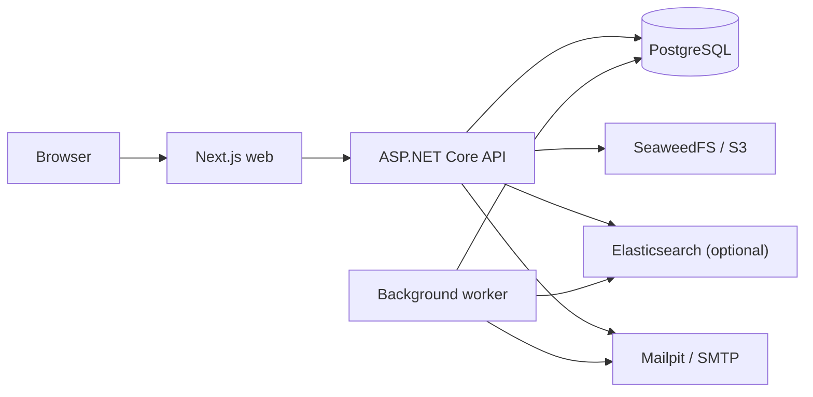

# TicketFlow

TicketFlow is a support ticket platform for customers, support agents, and administrators. It is a portfolio project built as a monorepo with a Next.js frontend, an ASP.NET Core modular monolith, and a separate background worker.

The core application is complete through ticket workflows, search and attachments, background jobs, dashboards, administration, localization, and a generated API client. It runs locally with Docker Compose and is verified in GitHub Actions.


## Features

- **Customer support:** register and sign in, create and edit tickets, exchange public replies, and close or reopen requests.
- **Agent workspace:** manage status, priority, and assignment; add internal notes; and review ticket history.
- **Private attachments:** upload and download PDF, PNG, JPEG, and UTF-8 text files on tickets or existing replies. Files are limited to 10 MiB each and 10 per ticket. Internal-note attachments are visible only to authorized staff.
- **Public ticket search:** search ticket numbers and public content with metadata and date filters. Elasticsearch is optional, so the ticket list remains available without it.
- **Dashboards and administration:** view role-scoped live ticket counts; administrators can manage categories and user roles.
- **Background jobs:** a transactional outbox and Hangfire worker handle notifications, reminders, escalations, retries, and operator replay. Mailpit captures email locally.
- **Four languages:** English, French, Spanish, and Persian (Iran), with right-to-left layout for Persian.
- **Generated API client:** OpenAPI supplies types, SDK operations, and TanStack Query options, keys, and mutation options through Hey API.

## Architecture



PostgreSQL is the source of truth. The API enforces ownership and role permissions; the worker processes the outbox and maintains the search index. Search is eventually consistent and considers a bounded window of up to 1,000 matching candidates before database authorization and hydration.

The frontend uses same-origin HttpOnly cookies, antiforgery tokens, and a shared transport for session refresh and account-change protection. Protected queries include the initiating account in their keys. Ticket writes use version checks to prevent silent overwrites.

| Path                    | Responsibility                                                                |
| ----------------------- | ----------------------------------------------------------------------------- |
| `apps/web`              | Next.js App Router frontend, feature modules, localization, and browser tests |
| `apps/backend`          | Domain, Application, Infrastructure, API, worker, and backend tests           |
| `packages/api-client`   | OpenAPI-generated TypeScript contracts, SDK, and TanStack Query helpers       |
| `infrastructure/docker` | Container build definitions                                                   |
| `docs`                  | Architecture decisions, runbooks, case study, and milestone verification      |

The repository and application directories contain `AGENTS.md` files with scoped AI and architecture guidance. See the [architecture overview](docs/architecture/overview.md), [Hey API decision](docs/decisions/0009-hey-api-tanstack-query.md), and [portfolio case study](docs/portfolio-case-study.md) for more detail.

## Run locally with Docker

Requirements: Git and Docker Desktop with Linux containers. Commands below use PowerShell from the repository root.

```powershell
git clone https://github.com/EhsanEbneKhodadad/ticketflow.git
cd ticketflow
Copy-Item .env.example .env
docker compose --profile app up -d --build --wait
```

The app profile starts PostgreSQL, SeaweedFS, Mailpit, the API, worker, and web app. One-shot services apply database migrations, seed development data, and prepare Hangfire storage. Normal API and worker startup do not migrate the schema.

Open [http://localhost:3000](http://localhost:3000). Other local services:

- API information: [http://localhost:5080/api/v1/system/info](http://localhost:5080/api/v1/system/info)
- API health: [http://localhost:5080/health/ready](http://localhost:5080/health/ready)
- Development OpenAPI document: [http://localhost:5080/openapi/v1.json](http://localhost:5080/openapi/v1.json)
- Mailpit: [http://localhost:8025](http://localhost:8025)
- S3-compatible storage: `localhost:8333`, with local credentials in `.env`

To enable search, set `SEARCH_ENABLED=true` in `.env` and start the search profile alongside the app:

```powershell
docker compose --profile app --profile search up -d --build --wait
```

The worker indexes public ticket content; updates may take time to appear. See the [search runbook](docs/runbooks/local-development.md#public-ticket-search) for configuration and limits.

### Demo accounts

The seed creates these development-only accounts. Their initial password is the `DEMO_PASSWORD` in `.env`; the sample value is `TicketFlowDemo!2026`.

| Role          | Email                       |
| ------------- | --------------------------- |
| Customer      | `customer@ticketflow.local` |
| Agent         | `agent@ticketflow.local`    |
| Administrator | `admin@ticketflow.local`    |

Public registration creates a customer account. Repeated seeding does not overwrite existing account passwords.

```powershell
docker compose --profile app --profile search down
```

This stops the stack while preserving Docker volumes and local data. The supplied credentials, seed accounts, and service configuration are for local development.

## Native development

For native app development and repository checks, install Node.js 24.21.0, pnpm 10.14.0, and .NET SDK 10.0.203. Docker is still used for local infrastructure and integration tests.

```powershell
Copy-Item .env.example .env
pnpm install --frozen-lockfile
dotnet tool restore
dotnet restore apps/backend/TicketFlow.sln --locked-mode
pnpm infra:up
```

Configure the database, storage, mail, and development environment in the relevant terminals. Apply migrations and seed with `--migrate --seed`, then prepare Hangfire storage with `--prepare-jobs` before enabling jobs in the worker. Start the API on port 5080, the worker, and `pnpm dev` in separate terminals. Compose reads `.env`; `dotnet run` needs environment variables set in its own terminal.

See [local development](docs/runbooks/local-development.md), [API setup](docs/runbooks/milestone-2-api.md), and [jobs setup](docs/runbooks/milestone-4-jobs.md#bootstrap-and-operations) for environment variables and commands. Next.js proxies `/api/v1` to the API; `API_INTERNAL_URL` selects the upstream when developing or building.

## Tests and CI

```powershell
pnpm format:check
pnpm lint
pnpm typecheck
pnpm test
pnpm build
pnpm e2e:typecheck
dotnet build apps/backend/TicketFlow.sln --no-restore
dotnet test apps/backend/TicketFlow.sln --no-restore
dotnet format apps/backend/TicketFlow.sln --verify-no-changes --no-restore
docker compose --env-file .env.example --profile app --profile search config --quiet
```

For end-to-end tests, start the seeded app with search enabled and Mailpit available, then run:

```powershell
pnpm --filter @ticketflow/web exec cypress install
pnpm e2e
```

Backend integration tests use Docker Testcontainers for dependencies. See the [local development runbook](docs/runbooks/local-development.md) for supported service overrides and focused test commands. [GitHub Actions](.github/workflows/ci.yml) runs frontend and backend checks, validates the generated contract and Compose configuration, and exercises real browser workflows against the container stack.

## API contracts and migrations

With the Development API running on port 5080, regenerate the client after an API contract change:

```powershell
pnpm api:generate
```

Generated files under `packages/api-client/src/generated` are not edited by hand. Database migrations are created with the EF tooling and applied explicitly; seeding requires Development, `Seed__Enabled=true`, and `--migrate`. See [API setup](docs/runbooks/milestone-2-api.md) and [local development](docs/runbooks/local-development.md).

## Project status and operations

The portfolio implementation is complete for local use and CI. It is not presented as a deployed production service; hosting, production credentials, monitoring, and backups need separate configuration.

The worker delivers notifications at least once, so a crash after SMTP accepts a message can result in a duplicate. For job thresholds, retries, and safe replay, see the [jobs runbook](docs/runbooks/milestone-4-jobs.md). Historical verification and screenshots are available in the [Milestone 2](docs/milestone-2-verification.md), [Milestone 3](docs/milestone-3-verification.md), [Milestone 4](docs/milestone-4-verification.md), and [Milestone 5](docs/milestone-5-verification.md) reports.
