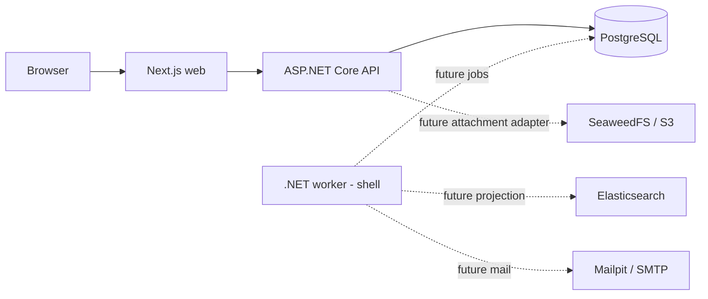

# Architecture

## Runtime

The browser uses Next.js. Same-origin /api/v1 requests proxy to ASP.NET Core. The API owns business authorization and writes PostgreSQL. The worker will process durable background work from the same database in Milestone 4. Elasticsearch is a derived index; SeaweedFS provides local S3-compatible storage; Mailpit captures development mail.

Solid arrows are implemented in the foundation; dashed integrations are planned.

## Code boundaries

- Domain: framework-free entities and business rules.
- Application: feature use cases, DTOs, policies, and interfaces; references Domain only.
- Infrastructure: persistence and integration adapters; references Application.
- API: HTTP composition root; references Application and Infrastructure.
- Worker: background composition root; references Application and Infrastructure.
- Web: thin routes, feature modules, shared UI primitives, and transport utilities.
- API client: generated OpenAPI TypeScript declarations, never manually duplicated DTOs.

Domain rules stay in Domain. Feature handlers live together within Application feature folders. Infrastructure implements application interfaces. Avoid generic repositories, microservices, message brokers, and shared mutable utility collections.

## HTTP and operations

- GET /api/v1/system/info returns the application name, release version, and environment.
- GET /health/live succeeds without database access.
- GET /health/ready requires PostgreSQL connectivity and no pending migrations.
- GET /openapi/v1.json is exposed in Development and Testing.
- Framework exceptions use Problem Details; logs are JSON with no request-body or credential logging.
- Migrations and seeding are explicit short-lived commands, never implicit host startup effects.

## Security evolution

Foundation exposes public system information only. Milestone 2 adds ASP.NET Identity, JWT cookies, rotating refresh sessions, antiforgery protection, ownership checks, and role policies. Root registration creates customers only. Public replies and internal notes must remain separated across API, search, notifications, and downloads.

Compose credentials and disabled Elasticsearch security are exclusively for loopback-bound local development. Hosting requires a separate production configuration.
