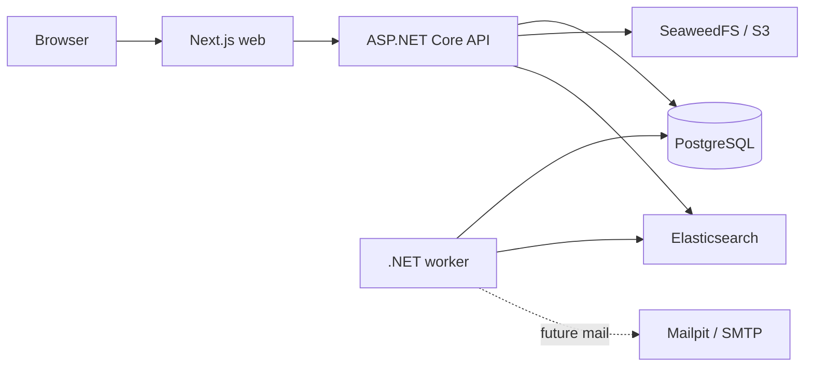

# Architecture

## Runtime

The browser uses Next.js. Same-origin /api/v1 requests proxy to ASP.NET Core. The API owns business authorization and writes PostgreSQL. The worker periodically reconciles public ticket search from the same database; durable background jobs arrive in Milestone 4. Elasticsearch is a derived index; SeaweedFS provides private S3-compatible attachments; Mailpit captures development mail.

Solid arrows are implemented through Milestone 3; dashed integrations are planned.

## Code boundaries

- Domain: framework-free entities and business rules.
- Application: feature use cases, DTOs, policies, and interfaces; references Domain only.
- Infrastructure: persistence and integration adapters; references Application.
- API: HTTP composition root; references Application and Infrastructure.
- Worker: background composition root; references Application and Infrastructure.
- Web: thin routes, feature modules, shared UI primitives, and transport utilities.
- API client: generated OpenAPI TypeScript declarations, never manually duplicated DTOs.

Domain rules stay in Domain. Feature handlers live together within Application feature folders. Infrastructure implements application interfaces. Avoid generic repositories, microservices, message brokers, and shared mutable utility collections.

## HTTP and operations

- GET /api/v1/system/info returns the application name, release version, and environment.
- GET /health/live succeeds without database access.
- GET /health/ready requires PostgreSQL connectivity and no pending migrations.
- GET /openapi/v1.json is exposed in Development and Testing.
- Framework exceptions use Problem Details; logs are JSON with no request-body or credential logging.
- Migrations and seeding are explicit short-lived commands, never implicit host startup effects.

## Security evolution

Foundation exposes public system information only. Milestone 2 adds ASP.NET Identity, JWT cookies, rotating refresh sessions, antiforgery protection, ownership checks, and role policies. Root registration creates customers only. Public replies and internal notes must remain separated across API, search, notifications, and downloads.

Compose credentials and disabled Elasticsearch security are exclusively for loopback-bound local development. Hosting requires a separate production configuration.

## Search projection

Application owns search inputs, safe response segments, index/store ports, and bounded replay. Infrastructure implements the public PostgreSQL projection/hydration and Elasticsearch 8.19 HTTP APIs with explicit mappings. Only the worker composition root registers the hosted reconciliation service. API hosts query the index and reauthorize/hydrate in PostgreSQL; they do not schedule projection work or depend on Elasticsearch readiness. Both hosts default search to disabled.

Elasticsearch sees ticket number/title/description/tags/public replies plus projection identity/ownership/creation and status/priority/category/agent filter fields. It never receives internal messages or any attachments. Each replay captures a ticket-number high-water mark and reads at most 100 tickets per batch; stable document IDs make replacements idempotent and index loss recoverable. Failures are logged and retried on the next cycle, without a durable outbox yet.

Search applies requester and requested metadata/date filters in Elasticsearch before considering at most 1000 scored/newest candidates. Current database ownership and filters determine visible rows and totals; snippets are current plain public text with highlight flags. Counts and pagination describe this authorized candidate window, never the raw index. See [decision 0006](../decisions/0006-public-search-projection.md) and the [search runbook](../runbooks/local-development.md#public-ticket-search).
