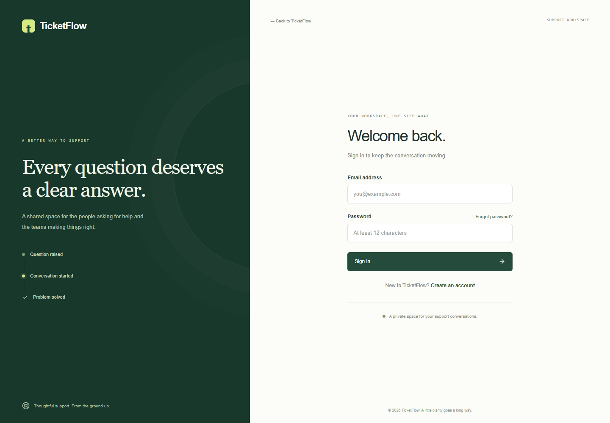
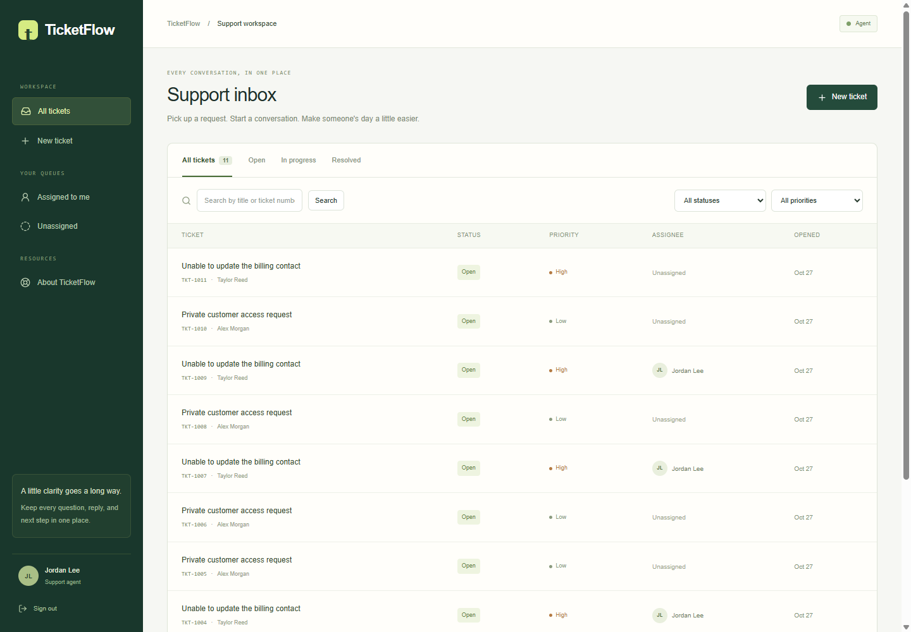
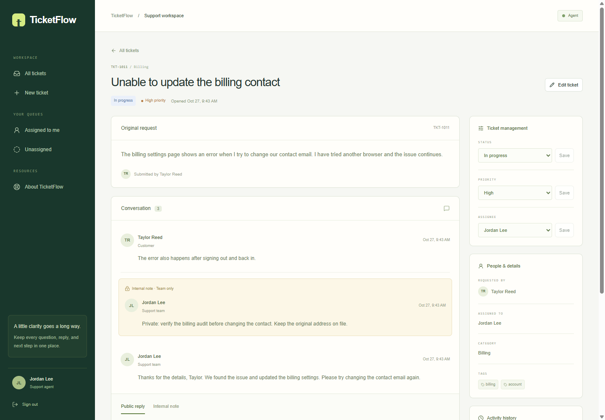
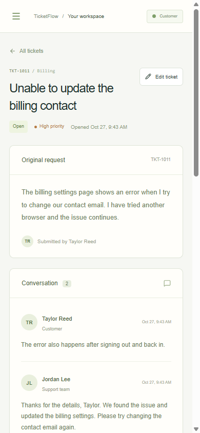

# Milestone 2 verification

## Scope

The backend and frontend are delivered as separate PRs. Backend PR #1 targets `main`; the frontend PR targets `feat/m2-backend` so its review contains only the web app, frontend tooling, CI browser checks, and evidence. Merge the backend first and retarget the frontend before merging it. Neither PR is merged automatically.

## Automated checks

- Backend: 30 passing tests, including 17 unit and 13 real PostgreSQL/HTTP integration tests. Backend GitHub Actions passed, including Docker Compose startup and API proxy health checks.
- Frontend: 11 passing Jest tests, including form validation, error handling, pre-hydration form safety, customer internal-note filtering, preserved conflict drafts, stable edit versions, cross-tab refresh rechecking, and responses arriving after account changes.
- Cypress: 3 real browser scenarios against the web proxy, ASP.NET API, PostgreSQL, and Mailpit. No mocked ticket or auth responses.
- Frontend lint, application TypeScript, Cypress TypeScript, formatting, and the production build all passed. The final Cypress run used the standalone production server and passed all 3 scenarios.

The Cypress suite registers a customer, creates/edits a ticket, sends public replies, assigns an agent, adds a staff-only note, resolves/closes/reopens the request, verifies guest and cross-customer isolation, checks a 390px viewport, and receives a real reset email. Password reset is submitted through the API; the new password is then verified through the sign-in UI.

The suite is also wired into the Compose CI job against the production web image. CI uploads screenshots on every browser run. Run locally with `pnpm e2e:typecheck` and `pnpm e2e` after starting the seeded stack. `TICKETFLOW_MAILPIT_URL` can override the test Mailpit UI/API origin; the default is `http://localhost:8025`.

## Screenshots

These screenshots are captured by the successful real browser workflow with development-only accounts and actual persisted requests. All metrics and messages come from the API.

## Local environment

Docker Desktop was unavailable on this Windows host. The local verification used a dedicated PostgreSQL 17 cluster on loopback port 55432, the published Development API on 5080, the web app on 3000, and Mailpit on 28025 (SMTP 21025). Database integration tests each created and dropped only a generated disposable test database. GitHub Actions provides the Docker verification.

No public application deployment is included. Attachments, search, background notification jobs, account-administration screens, and analytics remain later milestones.
