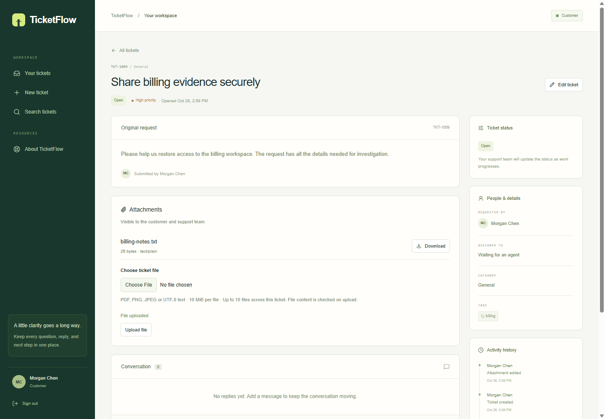
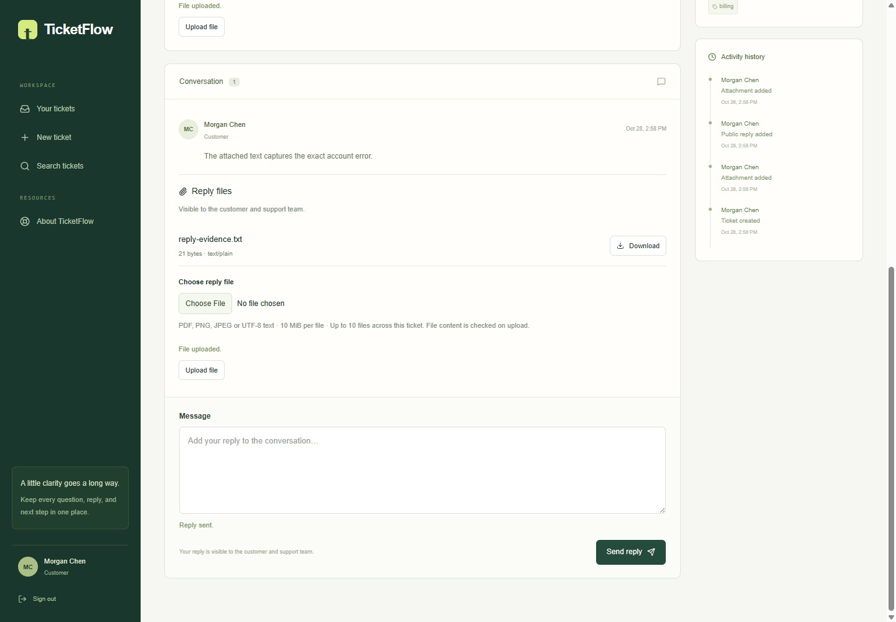

# Milestone 3 verification

## Environment and isolation

Milestone 3 builds on the unmerged Milestone 2 frontend branch. Existing Milestone 2 PRs and its development database remain unchanged. The new local development database is ticketflow_m3 on the existing isolated PostgreSQL 17 cluster.

Docker Desktop is unavailable on this Windows host. Real S3 tests use official SeaweedFS 4.51 bound to loopback port 18333 with private bucket access. Elastic's official Windows package endpoints return 403 from this host, so actual Elasticsearch integration and search-browser checks run in GitHub Actions with the official Elasticsearch 8.19.4 image. No fake search service substitutes for these acceptance checks.

## Backend verification

**82 backend tests passed in GitHub CI:** 38 unit tests and 44 PostgreSQL/HTTP/S3/Elasticsearch integration tests, with no failures or skips. Both the checks and production Compose jobs passed.

- [Backend PR #3](https://github.com/EhsanEbneKhodadad/ticketflow/pull/3)
- [Passing PR CI](https://github.com/EhsanEbneKhodadad/ticketflow/actions/runs/40676455027)
- [Passing branch CI](https://github.com/EhsanEbneKhodadad/ticketflow/actions/runs/40676380971)

Attachment coverage includes byte/name/size validation, ownership, internal-reply privacy, original download bytes and safety headers, CSRF, real Kestrel body limits and accepted URL variants, concurrent file-cap conflicts, PostgreSQL rollback, S3 cleanup, private object access and sanitized outage errors. A native smoke test of the published API also exercised PostgreSQL and actual SeaweedFS together and confirmed that a customer cannot list or download internal files.

Search coverage includes full-text public content and ticket numbers, metadata/date filters before the candidate window, current-DB authorization/count/snippet checks, safe highlights, replay/idempotence, stale ownership, index loss/rebuilding, and deletion between index setup and bulk writes. Exact-index templates preserve mappings during automatic recreation. The advertised camel-case query enums work on search and the existing ticket list; invalid/duplicate values return validation errors.

Release solution build, locked restore, C# formatting, generated API-contract consistency, frontend compatibility checks and Compose startup passed. Independent attachment and search reviews found two defects (route-size matching and index-loss mappings); both were fixed and their regressions passed.

## Frontend and browser evidence

The frontend uses generated API types, scoped queries and guarded multipart/binary transport. The original whole suite passed 27 tests; a subsequent delayed-options filter regression and its fix passed the focused search/attachment suite. TypeScript (app/shared and Cypress), ESLint, formatting and the final production build passed.

Five native browser journeys passed against the production web server, published API, PostgreSQL, Mailpit and actual SeaweedFS. These cover the existing M2 auth/ticket/reset workflow plus attachment upload/download, exact 10 MiB proxy upload, public reply files, conflict preservation, private/foreign file denial and closed-ticket states. Both attachment journeys passed again after the final display/framing correction. The genuine full-text browser scenario remains for the frontend CI stack with Elasticsearch and worker enabled.

Neither Milestone 2 nor Milestone 3 PRs are merged automatically.
